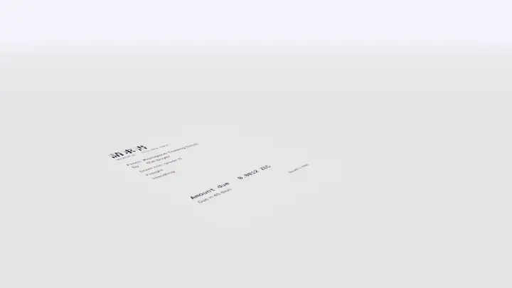
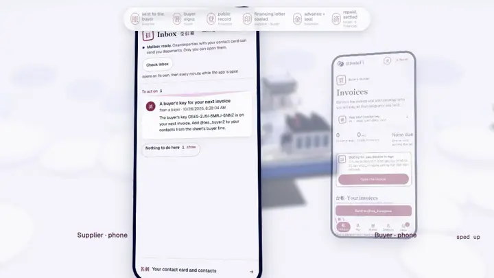
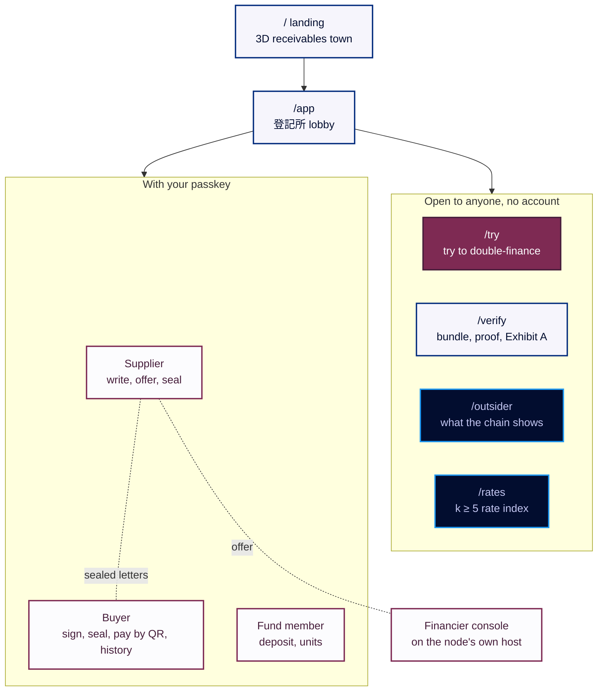
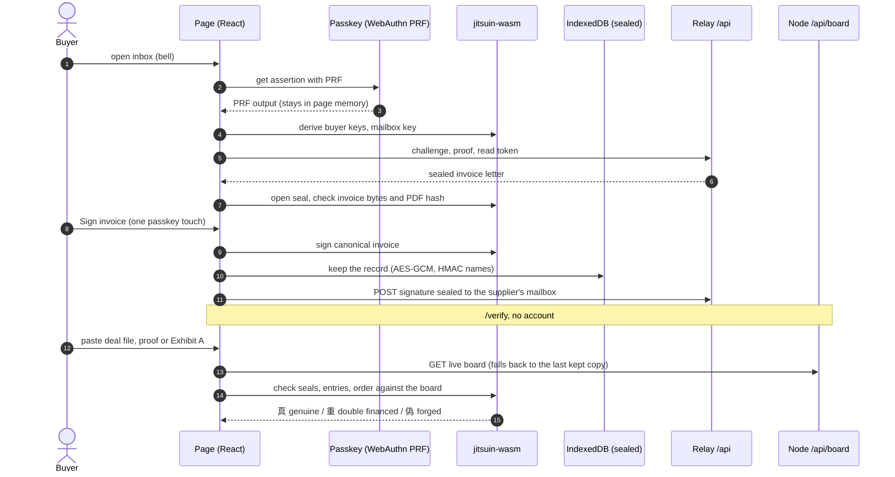
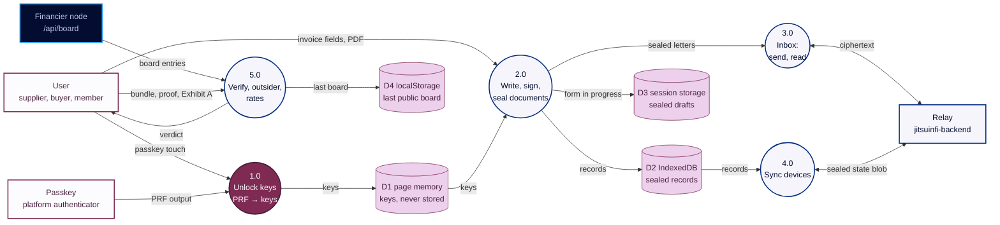

<p align="center">
  <a href="https://jitsuinfi.vercel.app"></a>
</p>

<p align="center">
  
  
  
  
  
  
  
</p>

<p align="center">
  <b>The web app: landing, supplier, buyer and fund-member desks, the verify page, the outsider view and the financier console. All cryptography runs in the page.</b>
</p>

<p align="center">
  <a href="https://jitsuinfi.vercel.app"><b>Landing</b></a> ·
  <a href="https://jitsuinfi.vercel.app/app"><b>App</b></a> ·
  <a href="https://jitsuinfi.vercel.app/try"><b>Try to double-finance</b></a> ·
  <a href="https://jitsuinfi.vercel.app/verify"><b>Verify</b></a> ·
  <a href="https://jitsuinfi-console-demo.vercel.app/console"><b>Console demo</b></a> ·
  <a href="https://youtu.be/RB9hKSLarJo"><b>2-min video</b></a>
</p>

<p align="center">
  <a href="https://youtu.be/RB9hKSLarJo"></a>
  <br><sub>Two minutes: the idea, a double-financing attempt caught live on the testnet board, and a whole deal from supplier to settlement.</sub>
</p>

Web app for **JitsuinFi**: supplier, buyer and fund-member desks with a sealed inbox, the financier console, a verify page for auditors and judges, and a page showing what outsiders can see. All cryptography runs in the browser through `jitsuin-wasm` (from `jitsuinfi-zcash`), so the page never has to trust a server's verdict.

Live: <https://jitsuinfi.vercel.app> (landing), [/app](https://jitsuinfi.vercel.app/app) (the app; installable as a PWA), [/verify](https://jitsuinfi.vercel.app/verify), financier console demo <https://jitsuinfi-console-demo.vercel.app/console>. Testnet txids of real deals: [jitsuinfi-zcash README](https://github.com/JitsuinFi/jitsuinfi-zcash#for-judges-verify-the-testnet-board). Other repos: [jitsuinfi-node](https://github.com/JitsuinFi/jitsuinfi-node) (financier node and console API), [jitsuinfi-backend](https://github.com/JitsuinFi/jitsuinfi-backend) (relay).

- React 19 and TanStack Router (HNK-31, D-52): one static single-page app with routes from files in `src/routes/`, built by Vite. Next.js was ruled out: its inline scripts break the strict CSP below.
- No CDN, no third-party requests, no trackers, no inline script. A strict Content-Security-Policy is sent by Vercel (`vercel.json`) and written into the built `index.html` (`'wasm-unsafe-eval'` is the only relaxation, needed for WebAssembly).
- Keys come from a passkey (WebAuthn PRF extension): no seed phrase, no key stored. A test secret stands in on devices without PRF.
- Keys stay in page memory. Deal documents (invoices, signatures, letters, seals, keys handed out, contacts) are kept on the device in IndexedDB, sealed with AES-GCM under a key derived from the passkey, with HMAC record names so the store does not show which invoices it holds (`src/lib/store.ts`).
- The same records sync to the account's other devices (same passkey) through the relay's one state per mailbox: AES-GCM under a key from the passkey, inside a seal to the owner's own mailbox, so the relay sees only ciphertext, its size and when it changes (`src/lib/sync.ts`). A form being written survives a reload, sealed in the tab's session storage and cleared when the tab closes or the action succeeds (`src/app/kept.ts`).
- Registering on the board, the Sign-to-Pay advance and the repayment watchdog run in the financier's node ([`jitsuinfi-node`](https://github.com/JitsuinFi/jitsuinfi-node), built on `jitsuin-flow`); this app covers what the browser does and verifies.

<table>
  <tr>
    <td width="50%" valign="top"><br><b>Kota Piutang, the landing's 3D town</b><br><sub>A cel-shaded receivables town (three.js) plays one invoice's life: seal, fingerprint to the board, advance, a copy refused, settled.</sub></td>
    <td width="50%" valign="top"><br><b>One fingerprint per invoice</b><br><sub>The buyer's jitsuin seals the invoice; only its fingerprint N reaches the public board.</sub></td>
  </tr>
  <tr>
    <td width="50%" valign="top"><br><b>/try: try to double-finance</b><br><sub>Case File #0417 against the live testnet board: 偽 when a digit changes, 重 when it is sold twice.</sub></td>
    <td width="50%" valign="top"><br><b>Phone first</b><br><sub>Supplier and buyer on phones: write, deliver sealed, sign with one passkey touch.</sub></td>
  </tr>
</table>

## Map of the app



<p align="center"></p>

## Flow in this repo (frontend)

Everything secret stays in the page: keys come from the passkey, signing and verification run in `jitsuin-wasm`, and only sealed ciphertext leaves the browser.

**Sequence: a buyer signs an invoice, then anyone verifies a deal**



**DFD: what the browser keeps and sends**


<sub>DFD legend: rectangles are external entities, circles are processes, cylinders are data stores; arrows carry the named data.</sub>

## Design: seal ink on document paper, Zcash as the deep pool

Shippori Mincho B1 for display, Geist for text, Geist Mono for real data only. Ten colours, no pure black or white: blues are Zcash (the shielded pool), plums are people (ink, signatures, the registered seal). Dark Raspberry is the only red, kept for the seal and primary actions. Full rules: [`MASTER.md`](MASTER.md).

<p align="center"></p>

## Pages

<details>
<summary>All routes and where their code lives</summary>

| Path | What | Code |
|---|---|---|
| `/` | Landing, six chapters | `src/app/Landing.tsx`, `src/landing/` |
| `/app` | The 登記所 lobby | `src/app/Lobby.tsx` |
| `/try`, `/try/play` | Try to double-finance (Case File #0417); `/try/play` plays itself for the video | `src/pages/TryPage.tsx`, `src/pages/try/` |
| `/verify`, `/outsider`, `/rates` | Verify a bundle, proof or Exhibit A; what outsiders see; the public rate index | `src/pages/VerifyPage.tsx`, `OutsiderPage.tsx`, `RatesPage.tsx` |
| `/account` | Sign-in (passkey) and the account menu | `src/pages/AccountPage.tsx` |
| `/supplier/invoices`, `/supplier/invoices/new`, `/supplier/deal/$ref`, `/supplier/contacts` | Supplier desk: invoices, write an invoice, one deal's steps, contacts | `src/pages/supplier/` |
| `/buyer/invoices`, `/buyer/invoices/$ref`, `/buyer/invoices/key`, `/buyer/pay`, `/buyer/history`, `/buyer/contacts` | Buyer desk: invoices to sign, the key for a supplier, repay by ZIP-321 QR, the payment history, contacts | `src/pages/buyer/` |
| `/member/fund`, `/member/units`, `/member/contacts` | Fund member: deposit and withdraw, check each holding against the period's root, contacts | `src/pages/member/` |
| `/app/contact` | A contact link (`/app/contact#<card>`): the card stays in the fragment, is checked and added in one confirm | `src/pages/ContactLinkPage.tsx` |
| `/financier` | A financier simulation, by address only; real financiers use the console | `src/pages/FinancierPage.tsx` |
| `/apply` | Apply for a financier node | `src/pages/ApplyPage.tsx` |
| `/console`, `/console/pair` | Financier console, on the console's own host (D-45) | `src/console/` |

A role page opens only in a session of that role. Signed in, a bell opens one inbox sheet for every sealed letter (a full-height sheet on a phone), with each letter's action inline (`src/app/InboxPanel.tsx`). `manifest.webmanifest` makes the app installable; the console host serves its own manifest (`console.webmanifest`). QR codes are scanned in the app (BarcodeDetector, or jsQR 1.4.0 where it is missing; `src/app/Scanner.tsx`, `src/lib/scan.ts`) under `Permissions-Policy: camera=(self)`.

The landing, the app and the console are three worlds loaded on demand; moving between them reloads the page, so their stylesheets never meet. Old addresses (`app.html#/supplier`, `#/index`, `console.html?view=pair`) are moved to these paths (`src/lib/legacy-url.ts`).

</details>

## Run

```bash
npm install
npm run wasm      # builds jitsuin-wasm from ../jitsuinfi-zcash into src/wasm/
npm run dev       # or: npm run build && npm run preview
```

Needs Rust with the `wasm32-unknown-unknown` target and `wasm-bindgen-cli 0.2.129` (see the `jitsuinfi-zcash` README). Status: in development for ZECATHON 2026, testnet.

**Network, in one place** (HNK-26.T19): the build is testnet unless `VITE_NETWORK=main` is set when building (`src/lib/network.ts`: labels, the shielded address check). The financier node takes `NETWORK` from its environment and the `jitsuin` CLI reads the network from the viewing key it is given, so a mainnet build never accepts a testnet address and the node refuses a board key of the other network.

<p align="center"></p>

## License

Licensed under either of [Apache License, Version 2.0](LICENSE-APACHE) or [MIT license](LICENSE-MIT), at your option. Unless you explicitly state otherwise, any contribution you submit for inclusion in this work, as defined in the Apache-2.0 license, is dual licensed as above, without any additional terms or conditions.
